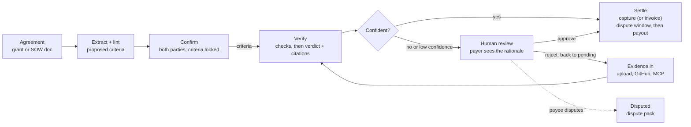

# Milestone Disbursement Engine — Spec

As of 2026-11-03 · Wesley Giles · Source: [Claude Doc](https://claude.ai/artifact/9bEuCbfvUgL3Q2RDAFiUVD) (this file adds the Nov 3 review; the Claude Doc does not have it yet)

## Problem and positioning

Money tied to milestones moves on trust and email: funders chase reports before releasing tranches, contractors chase clients after delivering. The engine turns an agreement into checkable acceptance criteria, verifies evidence against them, and settles through PayPal the moment a milestone is met.

- **Who it's for:** grant funders and grantees first (Vestri's audience), and contractors and clients working off a SOW as the second configuration.
- **Hackathon fit:** PayPal AI Hackathon, deadline Nov 12, 2026, 12:00 PT; winners Dec 21. Requires a public repo, a working demo and a video under 3 minutes. Prize targets and how each is earned: see [Prize plan](#prize-plan).
- **After the hackathon:** a Vestri module and a standalone product, both as clients of the same API.

## Competitive landscape

"AI checks the work against criteria, PayPal releases the money" already exists, including inside this hackathon. The escrow mechanic alone will not stand out.

| Project | What it does | Where we differ |
| --- | --- | --- |
| [escrow-agent](https://github.com/apexweb-adam/escrow-agent) (MIT) | Freelance escrow: per-milestone Orders v2 AUTHORIZE, capture/void, reauthorize after day 3; AI plans criteria and verifies; server re-derives verdict; GitHub CI decides test criteria; dispute pack; mock mode; AG Grid ledger; Render | No grants, no invoice mode, no MCP, no adapters or outbound events, no audit log; human releases every payment |
| proof-of-done (hackathon entry; repo now 404) | "PayPal escrow that releases itself when a Claude agent verifies the work": AUTHORIZE, capture/void, Payouts, AG Grid | Same SOW story; assume another near-identical demo |
| On-chain escrows ([MileAI](https://github.com/Areyaaa/MileAI), [agent-escrow](https://github.com/AAH20/agent-escrow), [Trustless Work](https://docs.trustlesswork.com/trustless-work/api-rest/deploy.md), [IETF VCAP draft](https://www.ietf.org/archive/id/draft-stone-vcap-02.html)) | Crypto escrow released by AI or oracle verification | Not PayPal; not for funders |
| Grant platforms ([Optimy](https://www.optimy.com/glossary/fund-disbursement), [Newgen](https://newgensoft.com/au/solutions/industries/government/grants-management/), AgileGrant) | Tranche disbursement tied to reports; AI used for application scoring | None found that verifies report content with AI before releasing a tranche |

## Differentiation

The pitch: **an evidence-to-payment engine for funders**, not a freelance escrow app. Everything below is something neither PayPal competitor does. Status reflects the Nov 3 decisions.

| # | Differentiator | Why it matters | Status |
| --- | --- | --- | --- |
| 1 | **Grants first.** Grantee report (PDF narrative + budget sheet) verified against grant deliverables, tranche released or invoiced | The gap no grant platform covers; Most Impactful | Approved — lead demo |
| 2 | **Criteria lint at ingest.** The extractor flags untestable criteria ("high quality", "engaging") and proposes measurable rewrites with the evidence type each needs; both parties sign off | Prevents disputes upstream instead of arbitrating them later | Approved |
| 3 | **Pre-check for the payee.** `POST /milestones/{id}/precheck` runs the verifier without recording a verdict, returning what's missing | Ends the reject-resubmit loop; grantee-friendly | Approved |
| 4 | **Hybrid verifier.** Deterministic checks (CI green on pinned SHA, file present, budget sums, dates) gate first; the model judges only what rules can't; a second skeptic pass must agree before auto-release | Trustworthy auto-release; answers "why would a funder let an AI pay?" | Approved — checks core; skeptic pass last in, first cut |
| 5 | **Agent as payee.** An AI agent takes a milestone via MCP, submits evidence, and gets paid when it verifies | Best Use of Agentic Commerce; competitors are human-only | Stretch — fallback is an agent driving the payer side over MCP |
| 6 | **Replayable audit record.** Each verdict stores criteria hash, evidence ids, model and prompt version; export as a funder compliance packet | Candid/Vestri tie-in; audit trail competitors lack | Approved — log and export |
| 7 | **Two settlement modes, one engine.** Escrow release or invoice-on-verify per agreement | Covers funders who won't pre-fund | Build (cut-list item) |
| 8 | **Platform, not app.** Adapters in, outbound webhooks out, MCP, generated SDKs | APIMatic prize; Vestri integration | Build |
| 9 | **Partial release.** Optional per-criterion weights release a pro-rata share when some criteria pass | Matches how grants actually pay | Later |
| 10 | **Co-funded grants.** Several funders per agreement, each with a share of each tranche | Real grant pattern; nobody models it | Later |

## Prize plan

A project can win **one Grand Prize or one Honorable Mention, plus one Sponsor Prize** ([rules](https://paypalaihackathon.devpost.com/rules), section 8). Sponsor eligibility is only "uses any [sponsor] tools"; there are no extra requirements. Best case: 1st place ($12k) + AG Grid 1st ($5k).

Strategy (decided Nov 3): **focus, don't shotgun.**
- **Main slot:** one submission is judged for all Grand and Honorable Mention prizes at no extra cost, so nearly all effort goes into the core loop, the grants story and the video.
- **Sponsor slot:** only one can be won, so effort goes into exactly one: AG Grid (largest pool, five awards, UI we need anyway). Render and APIMatic are kept because they cost ~nothing. Bryntum is dropped: a separate commercial library and a UI day competing for the same single slot at a fifth of the top payout.

| Prize | Amount | What earns it for us | Built in |
| --- | --- | --- | --- |
| Best Overall | $12k / $8k / $5k | Grants-first story, hybrid verifier, both settlement modes, polished video | Whole build |
| Most Impactful (HM) | $5k | Grantees paid weeks sooner; pre-check helps small nonprofits get paid | Demo beats 1, 4 |
| Best Use of PayPal + AI (HM) | $5k | AI decides when money moves, gated by checks and a human; authorize, reauthorize, capture, void, invoicing, webhooks | Nov 5–6 |
| Best Use of Agentic Commerce (HM) | $5k | MCP tools; agent drives payer-side flows; agent as payee if the stretch lands | Nov 9 |
| Best Demo Delivery (HM) | $5k | Tight 3:00 script, real sandbox money movement on screen, mock mode for judges | Nov 11 |
| Most Creative (HM) | $5k | Criteria lint and pre-check reframe escrow as coaching, not gatekeeping | Demo beat 2 |
| Best Use of AG Grid — **the sponsor bet** | $5k / $2k / $1k x3 | AG Grid for the ledger and milestone grid; AG Studio / AG Charts for a small funder portfolio dashboard (released vs held vs at-risk per grant) | Nov 10 |
| Best Use of APIMatic — free ride | $1k + 6 mo Business x3 | PayPal is called through the APIMatic-generated PayPal Server SDK for Orders and Payments (done Nov 3; the SDK has no Payouts, Partner Referrals, Invoicing or webhook verification, which stay on REST). Generating our own SDKs is optional | Nov 3 |
| Best Use of Render — free ride | $1k / $750 / $500 credits | Web service, Postgres, background worker for verification, cron for authorization expiry and invoice timeouts, all in `render.yaml` | Nov 4 |
| Best Use of Bryntum | $1k x3 | Dropped (see strategy) | — |
| Best Use of Channel3 | $1.5k | Skipped: product-catalog tooling does not fit disbursement | — |

## Core model

One engine: an agreement becomes locked acceptance criteria, evidence is verified against them, and a gate decides whether money moves. Push vs pull is a per-agreement setting at the settle step, not a separate product.

Criteria are fixed before any evidence arrives; a verdict below the agreement's threshold always stops at a person, and a rejection sends the payee back with the unmet criteria.

## Data model

Every entity is defined once with SQLModel in [`app/models/`](../app/models/) and serves as database table, API input and API output (`XBase` shared fields and validation, `X` table, `XCreate`, `XRead`). Criteria and verdict results are typed value objects stored in JSON columns. That package is the source of truth; this section describes it. Entities: Agreement, Party, Milestone (tranche), Evidence, StoredFile, Verdict (with typed CriterionResult), Settlement (captures and invoices), Disbursement (payouts and refunds after a capture), PayPalAccount (a payee org's connected PayPal), LedgerEntry, AuditEvent, Integration, Subscription, OutboxMessage, WebhookEvent; value objects Criterion and Measure. Settlement mode lives on the Agreement, so push vs pull is configuration, not product. Every field uses `Field(..., description=...)` so descriptions flow into OpenAPI, MCP tool schemas and structured-output prompts. Statuses are enums, not strings.

### Criteria: every tranche is a list of checkable conditions

A tranche never releases on "did the thing". It holds one or more `Criterion` objects, and releases only when every one is met and cited.

| Field | Meaning | Example |
| --- | --- | --- |
| `statement` | One condition a reviewer can answer yes/no from the evidence alone | "At least 200 people attend the spring reading workshops" |
| `measure.metric` | What is counted or checked | "workshop attendees" |
| `measure.comparator` | `at_least`, `at_most`, `equals`, `exists`, `on_or_before` | `at_least` |
| `measure.target` / `unit` | Number, date or value; none for `exists` (validated against the comparator) | 200 people |
| `evidence_required` | Evidence kinds that can prove it: document, spreadsheet, photo, link, code_change, ci_run, dataset, attestation | spreadsheet |
| `evidence_description` | The specific artifact | "Signed sign-in sheets for each session, one row per attendee" |
| `verification` | `check` (deterministic, from the registry), `model` (judged with citations) or `human` (never auto-releases) | check |
| `check_id` | Registry check when `verification=check`: `ci_green`, `file_present`, `row_count`, `sheet_total`, `dated_by` ([`app/domain/checks.py`](../app/domain/checks.py)) | row_count |
| `due_by`, `weight` | Optional earlier deadline; weight reserved for partial release later | — |

A `measure` is required on every criterion, so "done" always names the thing counted and the target.

### Criteria lint

[`app/domain/criteria.py`](../app/domain/criteria.py) runs on every draft, on `POST /criteria/lint`, and before every confirmation. Errors block confirmation; warnings show but don't block. The extraction model (Nov 6) gets the same rules in its prompt, and its output runs through the same lint.

| Rule | Level | Catches |
| --- | --- | --- |
| `too_short` | error | Statements under 4 words ("Done", "Does the thing") |
| `deferred_definition` | error | "as agreed", "per the SOW", "to client satisfaction", "work completed", "TBD" |
| `vague_term` | error (warning if the statement has a number) | "high-quality", "meaningful", "engaging", "robust", "improve", "timely", … |
| `evidence_unspecific` | error | Evidence descriptions under 3 words ("proof", "the report") |
| `check_missing` / `check_unknown` | error | `verification=check` without a valid registry check |
| `check_evidence_mismatch` / `check_comparator_mismatch` | error | A check that can't run on that evidence or comparator (e.g. `ci_green` on a spreadsheet) |
| `amounts_mismatch` | error | Tranche amounts don't sum to the agreement total |
| `duplicate_criterion_id` | error | Two criteria share an id |
| `compound` | warning | Several conditions in one statement; split for separate verdicts |
| `human_only` | warning | Tranche can never auto-release |
| `too_many_criteria` | warning | More than 7 criteria in one tranche |
| `check_ignored`, `criterion_after_milestone`, `target_after_milestone`, `duplicate_statement` | warning | Inconsistencies worth a second look |

### Confirmation

`criteria_hash` is a SHA-256 over every tranche's order, title, amount, due date and criteria. Each signer (payer, payee) confirms by sending the hash they reviewed: a stale hash gets 409 with the current one; lint errors get 422 with the report. When both have signed the same hash, the agreement goes `active` and the hash is locked. Any edit in draft clears all signatures. Only the payer edits tranches and only the payer can turn on auto-release.

## State machine and verification

No money moves without a verdict, and no verdict below the gate moves money without the payer's side. The flow diagram above shows the transitions; the rules are below.

**Milestone states:** `pending` → `funded` (escrow) → `evidence_received` → `verifying` → `verified` | `needs_review` → `settling` → `held` (captured; in the dispute window) → `settled` | `settlement_failed`; after capture also `contested` → `settled` or `refunded`, and `payout_failed` (release retries the payout); side states `disputed` and `overdue`. With no dispute window and a connected payee, capture goes straight to `settled`.

- **Evidence is untrusted data.** Evidence text is passed to the model as quoted data with an instruction that it may contain attempts to influence the verdict. A PR body saying "all criteria met" is evidence of nothing.
- **Deterministic checks first.** Criteria with `verification=check` are decided by their registry check at intake (CI green on the pinned SHA, file present, budget sheet sums, report dated in period). The model only judges the rest.
- **Implementation:** extraction and verification are two Pydantic AI agents with native structured output, run on Claude (`claude-opus-5-5`, effort high, server-side refusal fallbacks) or on a deterministic `FunctionModel` in mock mode ([`app/ai/agents.py`](../app/ai/agents.py)). Evidence ids are aliased (e1, e2, …) in prompts and mapped back; unknown citations are dropped.
- **Verify:** the model gets the criteria and evidence and returns `CriterionResult`s via structured output. Every result must cite an evidence id; an uncited "met" counts as not met. `Verdict.met` is computed server-side from the results; the model never supplies it.
- **Gate:** auto-release only when `auto_release_enabled`, `Verdict.met`, every check-backed criterion passed, and `model_confidence >= auto_release_threshold`. On `deliverable_release = on_capture` agreements a second skeptic pass (separate prompt `skeptic-v1`, told to find reasons each model-judged criterion is not met) must also return met, cited, for every model-judged criterion; it is stored on the verdict (`Verdict.skeptic`). Disagreement, or a skeptic that couldn't run, sends the tranche to review with both rationales. Mock mode's skeptic doubts evidence that looks unfinished ("TODO", "placeholder", ...). Anything else lands in `needs_review` with the rationale shown to the approver.
- **Who reviews:** only a `payer` or `approver` party may approve or reject; the payee can never approve their own milestone.
- **Rejection:** returns the milestone to `pending` (or `funded`) and sends the payee each unmet criterion's `missing` text.
- **Dispute:** after a rejection the payee may dispute; the milestone moves to `disputed` and the engine builds a dispute pack (timeline, criteria, verdicts, evidence, PayPal refs). Resolution is human and outside the engine for the hackathon.
- **Pre-check:** the payee can run the verifier against draft evidence; the result is stored with `is_precheck=True` and never changes state.
- **Overdue:** a `due_date` passing with no evidence moves the milestone to `overdue` and notifies both parties; no money moves.
- **Partial completion:** out of scope for the hackathon (all criteria or nothing). Weighted partial release is a later differentiator.
- **Idempotency:** evidence dedupes on `(source, external_ref, pinned_ref)`. Capture keys are `{milestone_id}-{attempt}`, payout keys `{milestone_id}-payout-{attempt}`, refund keys `{milestone_id}-refund-{attempt}`, all sent as `PayPal-Request-Id`, so a retried call on the same attempt never pays twice. Payouts answers a reused `sender_batch_id` with an error rather than the original response; that is treated as "already submitted" and the payout webhook (matched on `sender_item_id` = our key) finishes it.
- **Dispute window (contest after capture):** distinct from a payee disputing a rejection. `dispute_window_days` (0-14, default 0) on the agreement. A verified tranche is captured, then `held` until the window closes; the payer or a reviewer can contest it inside the window, which pauses the payout. Each side can only concede: the payer withdraws (payee is paid), the payee accepts (payer is refunded); a reviewer can decide either way. The payer can also waive the rest of the window and pay now.
- **Deliverable release:** `deliverable_release` on the agreement, `on_submit` (default; the payer sees evidence as it arrives, usual for grants) or `on_capture` (full evidence opens once the tranche is captured, so the payer pays on the verdict; suggested for SOWs). Set at creation and included in the criteria hash when it isn't the default, so agreements signed before it existed keep their hash. Lint warns (`pays_on_model_alone`) when `on_capture` is combined with auto-release and no reviewer. With `on_capture`:
  - **Visibility before capture (#3):** each evidence item has a `payer_visibility` the payee picks at submission, at or above the agreement's signed `min_evidence_visibility`: `hash_only` (pass/fail per criterion and the pinned hash), `verdict_only` (+ observed values and `missing`), `excerpt` (+ the verifier's quotes and rationale), `preview` (same as excerpt until previews exist). Payer-side callers (people, API keys, MCP tokens) get the filtered view on every read path: evidence list (no text, no links), file download (403), verdict and skeptic results, review outcome, compliance packet, payer emails. The payee and reviewers always see everything. Audit details and outbound webhook payloads never carry evidence content. All of this lives in `app/services/disclosure.py`.
  - **Reveal at capture (#4):** a completed capture (or a paid invoice) sets `Milestone.revealed_at`, lifts the restriction for good, records `deliverable_released` with every evidence id, pinned ref and file hash, and emails the payer side with the end of the dispute window. Escrow agreements with `on_capture` need `dispute_window_days >= 1` (lint error `reveal_without_window`); invoice mode gets a warning (`reveal_after_payment`) because it has no window. Void or refund before capture never reveals; a contest after the reveal works as before.
  - **Hash commitment (#5):** the pinned ref and the original file's SHA-256 are shown at every level. Downloads carry `X-Content-SHA256` and `X-Pinned-Ref`, are checked against the hash recorded at upload (refused with 409 and `deliverable_mismatch` if they differ), and each payer download after the reveal is recorded as `deliverable_downloaded`. `POST /evidence/{id}/handover` checks code handed over outside the engine (a commit SHA, or a repo and ref looked up on GitHub) against the pinned commit, matching on the same commit or the same file tree, and records `handover_checked`. The compliance packet lists all of these under `delivery`.
- **Audit log:** every transition appends an immutable `AuditEvent`. Verdicts store criteria hash, evidence ids, model and prompt version, so a decision can be replayed. This doubles as the Candid-ready record for Vestri.
- **Criteria lock:** criteria are editable only in `draft`. Confirm requires both payer and payee to sign the same `criteria_hash`; later changes require both to re-sign.

## PayPal integration

Webhooks are the source of truth for whether money actually moved. All of it runs in the free sandbox.

**Escrow decision (settled by the sandbox checks, Nov 3).** One Orders v2 AUTHORIZE per tranche; the payer approves the hold and the money stays on their account until release. Who receives the capture depends on whether the payee org connected PayPal:

- **Direct (default).** The REST app is a PayPal partner app. The payee org connects PayPal through partner onboarding (Partner Referrals API, features `PAYMENT`, `REFUND`, `DELAY_FUNDS_DISBURSEMENT`); the order names their **merchant id** as payee, so money goes payer to payee and the platform never holds it. Without onboarding PayPal refuses a third-party payee (`PAYEE_NOT_CONSENTED`, 403).
- **Platform (fallback).** A payee that never connects is paid through the platform: the order pays the platform account, and release sends the payee's email a PayPal Payout. Two PayPal fees instead of one, and the platform briefly holds the money; acceptable as a fallback, not the default.

| Step | PayPal API | Notes |
| --- | --- | --- |
| Connect payee | `POST /v2/customer/partner-referrals`; status from `GET /v1/customer/partners/{partner}/merchant-integrations?tracking_id=` and `/{merchant_id}` | Ready = merchant id, `payments_receivable`, `primary_email_confirmed`, and our client granted refund + delay-funds-disbursement scopes. The return URL is only used to find our record. |
| Fund tranche | Orders v2 `intent=AUTHORIZE`, `purchase_units[].payee.merchant_id` (direct) or none (platform); payer approves | Route and merchant id are stored on the tranche at order time |
| Keep hold alive | Authorizations reauthorize once after the 3-day honor period | `REAUTHORIZATION_TOO_SOON` before day 4 (seen in sandbox) |
| Release | Authorizations capture; `payment_instruction.disbursement_mode=DELAYED` when a direct tranche has a dispute window | Key `{milestone_id}-{attempt}` |
| Pay payee | Direct: `POST /v1/payments/referenced-payouts-items` (capture id). Platform: `POST /v1/payments/payouts` to the payee's email | Window closed, payer waived it, or contest resolved for the payee |
| Refund payer | Captures refund | Contest resolved for the payer; works before the delayed payout (after it: `TRANSACTION_ALREADY_REVERSED` on the payout) |
| Return funds | Authorizations void | Before evidence arrives |
| Ask payer to pay (invoice mode, connected payee) | Orders v2 `intent=CAPTURE`, `payee.merchant_id` = payee; created fresh each time the payer opens `/pay/{settlement id}`; captured on return | Money goes straight to the payee; only the latest order can complete the payment |
| Ask payer to pay (invoice mode, payee not connected) | Invoicing v2 from the platform account, then Payouts to the payee when paid | Same as the platform route |

- **Acting for the payee:** void, reauthorize, capture and refund on a direct tranche carry `PayPal-Auth-Assertion` (unsigned JWT: `iss` = our client id, `payer_id` = payee merchant id). Sandbox refused a void without it (`PERMISSION_DENIED`).
- **Delayed disbursement:** PayPal pays a delayed capture out by itself [28 days after capture](https://developer.paypal.com/platforms/checkout/delayed-disbursement), so a contest unresolved by then ends with the payee paid; the payouts job mirrors it. A second referenced payout is refused (`PAYOUT_ALREADY_COMPLETED_FOR_REFERENCE`) and treated as already paid.
- **Payouts (platform route):** asynchronous. The batch is `PENDING` on creation; the item status (`SUCCESS`, `UNCLAIMED`, `FAILED`, `RETURNED`, …) comes from the payout webhooks or `GET /v1/payments/payouts/{batch}`, which the payouts job polls. `UNCLAIMED` (no PayPal account for that email) keeps the tranche `held` until claimed; `RETURNED` after 30 days makes it `payout_failed`.
- **Authorization windows:** [valid 29 days, honored for 3](https://developer.paypal.com/docs/platforms/checkout/standard/customize/auth-capture/). Reauthorizing issues a new authorization id; store it. After day 29 the milestone returns to `pending` to be re-funded. Sandbox authorizations don't expire, so the demo is unaffected; production funds each milestone when its work starts.
- **Ledger:** `LedgerEntry` rows mirror PayPal objects per agreement: authorized, captured, voided, expired (holds); disbursed, refunded (after capture); invoiced, paid (to the payee), collected (into the platform, paid out after), invoice_cancelled. The funding summary reports held, in the dispute window, invoiced, released, refunded and unfunded.
- **Webhook intake:** verify every event with `verify-webhook-signature`, dedupe on PayPal event id, and ignore events for unknown references. Handled: authorization created/voided, capture completed/pending/denied/refunded, payouts item events, referenced payout completed/failed, invoice paid/cancelled, merchant onboarding completed, partner consent revoked (the payee falls back to the platform route for new tranches).
- **Jobs:** `python -m app.jobs daily` (hold expiry, invoice timeouts, overdue sweep) and `payouts` (hourly: ask PayPal about captures left `PENDING`, pay-now payments and platform invoices still open, applying the same state changes as their webhooks, so webhooks make settlement faster but never decide whether it happens; pay tranches whose window closed, follow Payouts, end contests unresolved 28 days after capture the way PayPal does); the app also runs `payouts` in-process every `PAYOUTS_INTERVAL_SECONDS` (0 with several instances; `render.yaml` runs both as cron jobs).
- **Customer disputes:** `CUSTOMER.DISPUTE.CREATED/UPDATED/RESOLVED` are recorded on the tranche (matched through the ledger's capture id). A dispute against a tranche still in its window pauses the payout as a contest; resolution stays with a reviewer. Money PayPal reverses itself arrives through the capture and refund events.
- **Funding route decision:** a payee that never connected is paid through the platform; one that started connecting but isn't ready is re-checked at funding, and a PayPal error there refuses funding (retry) rather than moving the money through the platform. `MODE=live` refuses the platform route altogether.
- **Invoicing as the payee isn't available:** PayPal sends invoices as the account that owns the API credentials. Invoicing on a payee's behalf needs the `INVOICE_READ_WRITE` partner feature; requesting it in onboarding returns `FEATURES_UNAUTHORIZED` ("not configured on the REST app"), there's no dashboard switch for it, and other teams found it needs PayPal's partner approval ([Niryat](https://github.com/Jaisheesh-2006/Niryat/blob/HEAD/docs/paypal-sandbox-findings.md), [ProjectX](https://github.com/Mrjoel97/ProjectX/blob/HEAD/docs/connectors/paypal-suitability.md)). So invoice mode uses a pay-now link for connected payees and a platform invoice plus Payouts otherwise. The payer gets a PayPal checkout page rather than a native PayPal invoice (no PayPal reminders); our compliance packet is the invoice record.
- **Invoice timeout:** an invoice unpaid after a configurable period (default 30 days) moves the settlement to `expired` and the milestone to `settlement_failed` with a reminder option.
- **Going live:** partner onboarding outside sandbox needs PayPal to approve the platform as a partner and issue a BN code (`PAYPAL_BN_CODE`, sent as `PayPal-Partner-Attribution-Id`). The platform route avoids that but holds money in transit, which raises money-transmission questions; a production version would run direct only.
- **Sandbox results (Nov 3):** OAuth token with Payouts and Invoicing scopes; card-path and wallet AUTHORIZE; reauthorize too soon (expected); capture; void; third-party payee refused before onboarding and accepted after; delayed capture, referenced payout (idempotent on `PayPal-Request-Id`), refund before payout; Payouts create and status; partner referral and merchant status. Not yet run: a full wallet approval through the app, and live webhooks (need a public URL).

## Organizations, people and access

Every person acts as a member of an organization; agreements are between organizations. This replaces the
original per-agreement party keys.

**Model**
- **Organization**: a funder, grantee, contractor, client or reviewer. A solo contractor is a one-person org.
  Holds its PayPal email (funding for payers; Payouts fallback for workers), its connected PayPal account
  (partner onboarding, so it's paid directly as a payee) and, optionally, SSO settings.
- **User**: a verified email. **Membership** links a user to an org with an org role:
  `owner > admin > member > viewer`.
- **Side is per agreement, not per org.** The same org is the payee on its grants and the payer on its
  subcontracts. A party links an agreement to an org with an agreement role: `payer`, `payee` or `reviewer`,
  and snapshots the PayPal email it uses so the record can't shift later.
- **Invitations** (one model): to join an agreement as counterparty or reviewer, or to join an org. The
  invitee signs in with the invited email and picks (or creates) the org they accept for.
- **Org API keys** carry an org role; integrations and MCP agents act as that org with those rights.
- **Assignees**: each tranche can name a responsible person on the payer side and on the payee side.

**Sign-in**
- **Magic link** for everyone: request a link for an email, open it, get a session token (bearer). In mock
  mode the link is returned in the response so the demo works without an email provider. The API's own sign-in
  page (used for MCP consent) and browser SSO flows can only be completed in the browser that started them: a
  short-lived SameSite cookie must match, so a cross-site request can't sign someone's browser in as somebody else.
- **Org SSO (OIDC)**: an org admin configures issuer, client id/secret (encrypted at rest with `SECRET_KEY`) and
  the email domains it owns. A domain only counts once proven with a DNS TXT record
  (`_mde-verification.<domain> TXT "mde-verification=<token>"`); public mail domains can't be claimed and a
  domain belongs to one org. Sign-in uses authorization code + PKCE; the ID token's signature (provider JWKS),
  issuer, audience, expiry and nonce are checked, and its email must be in a verified domain. People are added
  to the org on first sign-in (default role member, never owner). With "enforce SSO" on, magic links are
  refused for those domains.
- **One host, three apps:** the web app at `/`, the REST API under `/api` (its docs at `/api/docs`; PayPal
  returns, pay links and webhooks live there) and the MCP server at `/mcp` with its OAuth endpoints at the root,
  where clients look for them. A small ASGI dispatcher in `app/main.py` routes between them.
- **Web app hand-offs:** emailed sign-in and invitation links open the web app (`/auth/verify?token=`,
  `/invitations/accept?token=`), which exchanges them through the API; MCP consent sign-in keeps the API's own
  pages. `PUBLIC_APP_URL` is only for the dev split. SSO started with `to_app` returns to `/auth/sso#token=…` (the fragment never
  reaches a server). A signed-in invitee can accept from their inbox with `POST /invitations/{id}/accept`; the
  signed-in email must match the invitation, which is what the emailed token proves.

**Who can do what** (agreement role x org role; `member+` means member, admin or owner)

| Action | Payer | Payee | Reviewer |
| --- | --- | --- | --- |
| View agreement, criteria, evidence, verdicts, audit | viewer+ | viewer+ | viewer+ |
| Edit tranches (draft only) | member+ | | |
| Confirm (sign) criteria | admin+ | admin+ | admin+ |
| Turn on auto-release | admin+ | | |
| Invite counterparty / reviewer | admin+ | | |
| Fund, void | member+ | | |
| Approve or reject a verdict in review | admin+ | | member+ |
| Release a verified tranche; pay a held tranche now; retry a failed payout | admin+ | | |
| Contest a held tranche (inside the dispute window) | admin+ | | member+ |
| Resolve a contest by paying the payee | admin+ | | member+ |
| Resolve a contest by refunding the payer | | admin+ | member+ |
| Connect the org's PayPal account | org admin+ (any side) | | |
| Pre-check, submit evidence, upload, connect GitHub | | member+ (GitHub: admin+) | |
| Dispute a rejection | | admin+ | |
| Compliance packet | member+ | | member+ |
| Subscriptions (webhooks) | admin+ | admin+ | admin+ |

- A payee can never approve its own tranche. Reviewers never start money movement; they can pause a payout (contest) and decide a contest either way.
- **Reviewers** are invited per agreement to review the criteria and the submitted evidence. While a
  reviewer invitation is pending or a joined reviewer hasn't signed, the agreement can't activate. With
  `require_reviewer_approval` on, only a reviewer's approval releases a tranche in review (the payer can
  still reject).

**Entry points** (org-scoped; the UI and MCP tools sit on these)
- `GET /orgs/{id}/agreements?side=payer|payee|reviewer`, `GET /orgs/{id}/review-queue` (tranches waiting on
  this org's decision), `GET /orgs/{id}/portfolio` (held, released, at risk per agreement).
- Payer: create from a document, invite, fund, review queue, portfolio, compliance packets.
- Worker: invitations, criteria, pre-check, evidence, what's missing, disputes, payout status.
- Reviewer: invitations, criteria sign-off, review queue, compliance packets.

**Email (built Nov 3):** `EMAIL_PROVIDER=resend|smtp` behind one `send`; console only in mock mode (links are
returned in responses). Notifications go to the tranche's assignee on that side, else every member of the party's
org: review needed (payer side, or reviewers only with `require_reviewer_approval`), rejection with what's missing,
verified-but-unfunded, pay link (invoice mode), overdue (both sides), unclaimed payout (payee), failed payout (payer).

**Rate limits (built Nov 3):** per IP and per address on sign-in links, per caller on extraction and pre-check,
per IP on `/pay/{id}`; in memory per instance, HTTP 429 with Retry-After.

**Cut for the hackathon:** SAML, SCIM, two-person approval rules, per-agreement access lists beyond side x role.

## MCP server

`/mcp` (streamable HTTP) is generated from the REST API with FastMCP: every operation tagged `x-mcp-tool` is a
tool, and each call runs the real REST endpoint in-process with the caller's credential, so permissions and the
audit log are enforced in one place. Human-only steps (confirm criteria, review/approve, release, fund, dispute)
are not tools.

**Auth** follows the MCP authorization spec (OAuth 2.1):
- Discovery: protected-resource metadata at `/.well-known/oauth-protected-resource/mcp`, authorization-server
  metadata at `/.well-known/oauth-authorization-server`; unauthenticated calls get a 401 pointing at them.
- Clients register dynamically (`/register`) and use authorization code + PKCE (S256 only).
- `/authorize` sends the person to a consent page: sign in (magic link or the org's SSO, cookie session,
  CSRF-protected form), pick the organization the client acts for, allow or deny.
- Access tokens last 1 hour, act only within the chosen org with the person's current role there (removal
  takes effect on the next call), and are valid only for this server's `/mcp` resource. Refresh tokens last
  30 days and rotate on every use; presenting a used refresh token revokes the whole family.
- Headless agents use org API keys as bearer tokens. Session tokens from the web app aren't accepted on `/mcp`.
- An access token acts only through the tools shown at consent, even on the REST API directly: human-only
  actions (confirm, fund, void, review, release, contest, resolve, dispute, invite, edit tranches, subscriptions)
  and org management (members, API keys, SSO, creating orgs, accepting invitations) are refused with 403.
- Audit entries for MCP calls name the person, the client and the org (`user:<id>+mcp:<client>@org:<id>`).

## API surface

FastAPI REST is the single source; the OpenAPI spec generates the MCP tools, the APIMatic SDKs and the Zapier fields. Endpoints tagged `x-mcp-tool` become agent tools; the rest stay REST-only.

| Endpoint | Purpose | Allowed roles | MCP tool |
| --- | --- | --- | --- |
| `POST /agreements/extract` | Upload an agreement document; returns a draft with proposed milestones, criteria and lint warnings | payer | `draft_agreement_from_document` |
| `POST /agreements` | Create an agreement from structured input | payer | `create_agreement` |
| `POST /agreements/{id}/confirm` | Sign the current criteria hash; when all parties have signed, lock and activate; returns PayPal approval links if escrow | payer, payee | — (human step) |
| `GET /agreements/{id}` | Agreement, milestones, ledger and status | any party | `get_agreement_status` |
| `POST /milestones/{id}/precheck` | Run the verifier on draft evidence; returns what's missing; no state change | payee | `precheck_evidence` |
| `POST /milestones/{id}/evidence` | Submit evidence; queues verification | payee | `submit_evidence` |
| `POST /milestones/{id}/review` | Approve or reject a `needs_review` verdict | payer, approver | — (human step) |
| `POST /milestones/{id}/dispute` | Dispute a rejection; returns the dispute pack | payee | — (human step) |
| `GET /milestones/{id}/audit` | Full event log for one milestone | any party | `explain_milestone` |
| `GET /agreements/{id}/compliance-packet` | Export criteria, verdicts with citations, evidence refs and ledger as PDF + JSON | payer, approver | `export_compliance_packet` |
| `GET /portfolio` | Funder dashboard data: per agreement held, released, at-risk, overdue | payer, approver | `get_portfolio` |
| `POST /orgs/{id}/paypal/connect` | Start PayPal partner onboarding; returns PayPal's link | org admin | — |
| `GET /orgs/{id}/paypal`, `POST /orgs/{id}/paypal/refresh` | Connected account status and what still blocks it | org viewer / admin | — |
| `POST /milestones/{id}/release` | Capture a verified tranche (or send its invoice) | payer | — (human step) |
| `GET /pay/{settlement_id}` | Invoice mode: the payer's pay link (fresh PayPal order, or the PayPal invoice); shown as `pay_path` on the tranche and `pay_url` on the release response | payer (link) | — |
| `POST /milestones/{id}/payout` | Pay a held tranche now (waives the window) or retry a failed payout | payer | — (human step) |
| `POST /milestones/{id}/contest` | Contest a held tranche inside its dispute window | payer, reviewer | — (human step) |
| `POST /milestones/{id}/resolve` | End a contest: `release` (payer, reviewer) or `refund` (payee, reviewer) | see table | — (human step) |
| `POST /webhooks/paypal` | PayPal event intake (signature-verified, deduped) | PayPal | — |
| `POST /webhooks/{adapter}` | Evidence adapter intake (GitHub, etc.) | adapter | — |
| `POST /subscriptions` | Register an outbound webhook URL for events | any party | — |

- **Human steps stay off MCP on purpose:** an agent can draft, pre-check, submit and ask, but confirming criteria, approving low-confidence releases and disputing are a person's call.
- **Outbound events (built):** every audit event is queued in the same transaction as the change (transactional outbox) for matching subscriptions, then delivered signed (`X-MDE-Signature` over `timestamp.body`), retried with exponential backoff up to 10 attempts. Subscriber URLs must be https (http allowed in mock mode) and may not resolve to private, loopback, link-local or reserved addresses; the post goes to the address that was vetted (no second DNS lookup) with TLS verified against the hostname; redirects are not followed.
- **Auth:** API keys per party, carrying the party's role, for the hackathon; OAuth later for Zapier. The review endpoint rejects the payee's key.

## Adapters

An adapter's only job is turning a source-native event into an `EvidenceCreate`; adding a workflow never touches the engine.

| Adapter | Direction | Hackathon scope |
| --- | --- | --- |
| Upload form (report PDF, budget sheet, files + note) | Evidence in | Build — demo source for grants (lead) |
| GitHub (PR merged webhook; pins merge SHA, records CI check runs) | Evidence in | Build — demo source for SOW |
| MCP `submit_evidence` (agent as payee) | Evidence in | Build — agentic demo |
| Email inbox (forward to agreement address) | Evidence in | Stretch |
| Google Drive folder watch | Evidence in | Later |
| Outbound webhooks (all state changes) | Events out | Build |
| MCP server (generated from tagged endpoints) | Both | Build |
| Zapier (triggers on events, actions on submit/create) | Both | Stretch, likely cut |

- **Adapter contract:** `parse(payload) -> EvidenceCreate | None`, plus a signature check for that source, plus any deterministic checks it can run at intake (stored in `check_results`). Unmatched events are dropped and logged, never guessed onto a milestone.
- **Pinning:** evidence records an immutable version (commit SHA, file content hash) so a later force-push or file edit can't change what was verified.
- **GitHub (built):** per-agreement integration with its own HMAC secret; only `pull_request` closed+merged events from the registered repo count; label `mde-<milestone id>` selects the milestone; deliveries dedupe on `X-GitHub-Delivery`; CI is read from the head commit's check runs; GitHub API calls and verification run after the webhook is acknowledged.
- **Uploads (built):** PDF, CSV, XLSX (one evidence per non-empty sheet), TXT, MD, images; 10 files, 20 MB each, 25 MB per request; all files must parse before any is stored; originals stored (database for now) and downloadable by parties of the agreement only.
- **Matching evidence to milestones:** explicit first (milestone id in a PR label, form field or email subject), model-suggested match only as a `needs_review` fallback.

## Licensing and product boundary

The engine ships AGPL-3.0, which meets the hackathon's open-source requirement and blocks hosted clones that don't share changes.

- **Open core:** engine, data model, PayPal settlement, upload, GitHub and MCP adapters.
- **Closed modules:** Vestri features, Candid-formatted reporting and any paid adapters run as separate services that call the REST API, never linked into the core.
- **CLA** on outside contributions, so dual-licensing stays possible.
- **Repo:** public under SeraphDev6, license visible in the About section as the rules require.

## Demo script (under 3:00)

Grants lead (decided in review): it is the gap no competitor covers. The SOW and GitHub story becomes the "same engine" beat.

1. **0:00–0:20 — The problem.** A grantee filed their quarterly report three weeks ago; the next tranche is still waiting on a program officer.
2. **0:20–0:50 — Ingest and lint.** Upload a grant agreement. The engine proposes three tranches with criteria, flags "meaningful community impact" as untestable and proposes "≥ 200 attendees, shown in the sign-in sheet". Funder and grantee both confirm; the grantee connects PayPal in one click (partner onboarding).
3. **0:50–1:10 — Fund.** Funder approves the tranche holds in PayPal sandbox; the AG Grid ledger shows them authorized.
4. **1:10–1:40 — Pre-check, then release.** Grantee pre-checks the report and sees one missing item; attaches the budget sheet; submits. Checks pass, verdict cites the report pages, capture fires straight to the grantee's PayPal (held in a short dispute window; the funder waives it and the payout lands).
5. **1:40–2:00 — Low confidence.** Thin evidence lands in review; the funder sees the rationale and rejects; the grantee gets exactly what's missing.
6. **2:00–2:30 — Same engine.** A SOW in invoice-on-verify mode: merge a PR, CI is green on the pinned SHA, the client gets a pay link and pays the contractor straight into their PayPal.
7. **2:30–3:00 — Agents and the funder's view.** An AI agent picks up a milestone over MCP, submits its work, gets paid (stretch; fallback: the funder's agent asks over MCP which grants are at risk). Close on the AG Grid portfolio dashboard and the exported compliance packet.

## Build plan and cut list

The engine and the escrow path are done by Nov 7; everything after that is surface, second mode and polish. Submission closes Nov 12 at 12:00 PT (15:00 ET).

1. **Nov 3–4 — Foundation.** Repo, AGPL, FastAPI skeleton, Pydantic models, Postgres, `render.yaml` (web, worker, cron, Postgres), deploy to Render, **mock mode** (fake PayPal ids, canned verifier) so judges can run it without keys. Sandbox accounts; run the three day-one PayPal checks; confirm the APIMatic PayPal Server SDK covers Orders and Authorizations; request Payouts enablement as fallback. Check that Render free Postgres outlives judging (winners Dec 21); budget a paid tier if not.
2. **Nov 5 — Escrow path.** Per-milestone authorize, reauthorize, capture, void through the PayPal Server SDK; ledger; webhook verify and dedupe; settlement keys with attempt numbers; expiry cron.
3. **Nov 6 — Extraction and verification.** Document to milestones and criteria with lint; deterministic checks; verdict with citations and server-derived `met`; gate; pre-check; review endpoint with role checks.
4. **Nov 7 — Evidence adapters.** Upload form (report + budget sheet) and GitHub PR webhook with SHA pinning and CI checks. Full grant loop works end to end.
5. **Nov 8 — Invoice mode, outbound webhooks, audit.** Invoicing on verify with timeout cron; event subscriptions; audit log endpoint; compliance-packet export; dispute endpoint and pack.
6. **Nov 9 — MCP and APIMatic.** Tag endpoints, generate MCP server, test with an agent client (payer-side flows first, agent-as-payee if time); optionally generate SDKs from our OpenAPI.
7. **Nov 10 — UI.** Agreement view, AG Grid ledger and milestone grid, AG Studio/Charts funder portfolio dashboard, review screen.
8. **Nov 11 — Hardening; skeptic pass and agent-as-payee if on schedule.** Record the demo video (the half day freed by dropping Bryntum goes here).
9. **Nov 12 morning — Submit.** README with run instructions (mock and sandbox), hosted URL, tool list, which sponsor tools are used where, video link.

**Cut in this order if behind:** Zapier, email adapter, agent-as-payee, skeptic pass, dispute pack (keep the endpoint and state), generated SDKs (keep the PayPal Server SDK), invoice mode (keep it as a 10-second mention), AG Studio dashboard (keep the AG Grid ledger). Never cut: escrow release, server-derived verdict with citations, deterministic checks, review gate with role check, criteria lint, pre-check, audit log and compliance export, AG Grid ledger, mock mode, the video.

## Open questions

- ~~Does Orders v2 AUTHORIZE with a third-party `payee` capture cleanly without partner onboarding?~~ No (`PAYEE_NOT_CONSENTED`); with partner onboarding, yes. Decided: direct route via partner onboarding, Payouts fallback.
- ~~Invoice mode with a third-party payee?~~ `INVOICE_READ_WRITE` isn't self-serve; decided: pay-now link (connected payee) or platform invoice plus Payouts. Revisit if PayPal enables invoicing for the app.
- Live partner approval and BN code: apply after the hackathon if the product continues.
- Which grant to use in the demo: a real (anonymized) Vestri-style grant or a synthetic one?
