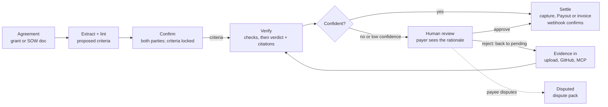

# Milestone Disbursement Engine — Spec

As of 2026-11-03 · Wesley Giles · Source: [Claude Doc](https://claude.ai/artifact/9bEuCbfvUgL3Q2RDAFiUVD) (this file adds the Nov 3 review; the Claude Doc does not have it yet)

## Problem and positioning

Money tied to milestones moves on trust and email: funders chase reports before releasing tranches, contractors chase clients after delivering. The engine turns an agreement into checkable acceptance criteria, verifies evidence against them, and settles through PayPal the moment a milestone is met.

- **Who it's for:** grant funders and grantees first (Vestri's audience), and contractors and clients working off a SOW as the second configuration.
- **Hackathon fit:** PayPal AI Hackathon, deadline Nov 12, 2026, 12:00 PT; winners Dec 21. Requires a public repo, a working demo and a video under 3 minutes. Prize targets and how each is earned: see [Prize plan](#prize-plan).
- **After the hackathon:** a Vestri module and a standalone product, both as clients of the same API.

## Competitive landscape

"AI checks the work against criteria, PayPal releases the money" already exists, including inside this hackathon. The escrow mechanic alone will not stand out.

| Project | What it does | Where we differ |
| --- | --- | --- |
| [escrow-agent](https://github.com/apexweb-adam/escrow-agent) (MIT) | Freelance escrow: per-milestone Orders v2 AUTHORIZE, capture/void, reauthorize after day 3; AI plans criteria and verifies; server re-derives verdict; GitHub CI decides test criteria; dispute pack; mock mode; AG Grid ledger; Render | No grants, no invoice mode, no MCP, no adapters or outbound events, no audit log; human releases every payment |
| proof-of-done (hackathon entry; repo now 404) | "PayPal escrow that releases itself when a Claude agent verifies the work": AUTHORIZE, capture/void, Payouts, AG Grid | Same SOW story; assume another near-identical demo |
| On-chain escrows ([MileAI](https://github.com/Areyaaa/MileAI), [agent-escrow](https://github.com/AAH20/agent-escrow), [Trustless Work](https://docs.trustlesswork.com/trustless-work/api-rest/deploy.md), [IETF VCAP draft](https://www.ietf.org/archive/id/draft-stone-vcap-02.html)) | Crypto escrow released by AI or oracle verification | Not PayPal; not for funders |
| Grant platforms ([Optimy](https://www.optimy.com/glossary/fund-disbursement), [Newgen](https://newgensoft.com/au/solutions/industries/government/grants-management/), AgileGrant) | Tranche disbursement tied to reports; AI used for application scoring | None found that verifies report content with AI before releasing a tranche |

## Differentiation

The pitch: **an evidence-to-payment engine for funders**, not a freelance escrow app. Everything below is something neither PayPal competitor does. Status reflects the Nov 3 decisions.

| # | Differentiator | Why it matters | Status |
| --- | --- | --- | --- |
| 1 | **Grants first.** Grantee report (PDF narrative + budget sheet) verified against grant deliverables, tranche released or invoiced | The gap no grant platform covers; Most Impactful | Approved — lead demo |
| 2 | **Criteria lint at ingest.** The extractor flags untestable criteria ("high quality", "engaging") and proposes measurable rewrites with the evidence type each needs; both parties sign off | Prevents disputes upstream instead of arbitrating them later | Approved |
| 3 | **Pre-check for the payee.** `POST /milestones/{id}/precheck` runs the verifier without recording a verdict, returning what's missing | Ends the reject-resubmit loop; grantee-friendly | Approved |
| 4 | **Hybrid verifier.** Deterministic checks (CI green on pinned SHA, file present, budget sums, dates) gate first; the model judges only what rules can't; a second skeptic pass must agree before auto-release | Trustworthy auto-release; answers "why would a funder let an AI pay?" | Approved — checks core; skeptic pass last in, first cut |
| 5 | **Agent as payee.** An AI agent takes a milestone via MCP, submits evidence, and gets paid when it verifies | Best Use of Agentic Commerce; competitors are human-only | Stretch — fallback is an agent driving the payer side over MCP |
| 6 | **Replayable audit record.** Each verdict stores criteria hash, evidence ids, model and prompt version; export as a funder compliance packet | Candid/Vestri tie-in; audit trail competitors lack | Approved — log and export |
| 7 | **Two settlement modes, one engine.** Escrow release or invoice-on-verify per agreement | Covers funders who won't pre-fund | Build (cut-list item) |
| 8 | **Platform, not app.** Adapters in, outbound webhooks out, MCP, generated SDKs | APIMatic prize; Vestri integration | Build |
| 9 | **Partial release.** Optional per-criterion weights release a pro-rata share when some criteria pass | Matches how grants actually pay | Later |
| 10 | **Co-funded grants.** Several funders per agreement, each with a share of each tranche | Real grant pattern; nobody models it | Later |

## Prize plan

A project can win **one Grand Prize or one Honorable Mention, plus one Sponsor Prize** ([rules](https://paypalaihackathon.devpost.com/rules), section 8). Sponsor eligibility is only "uses any [sponsor] tools"; there are no extra requirements. Best case: 1st place ($12k) + AG Grid 1st ($5k).

Strategy (decided Nov 3): **focus, don't shotgun.**
- **Main slot:** one submission is judged for all Grand and Honorable Mention prizes at no extra cost, so nearly all effort goes into the core loop, the grants story and the video.
- **Sponsor slot:** only one can be won, so effort goes into exactly one: AG Grid (largest pool, five awards, UI we need anyway). Render and APIMatic are kept because they cost ~nothing. Bryntum is dropped: a separate commercial library and a UI day competing for the same single slot at a fifth of the top payout.

| Prize | Amount | What earns it for us | Built in |
| --- | --- | --- | --- |
| Best Overall | $12k / $8k / $5k | Grants-first story, hybrid verifier, both settlement modes, polished video | Whole build |
| Most Impactful (HM) | $5k | Grantees paid weeks sooner; pre-check helps small nonprofits get paid | Demo beats 1, 4 |
| Best Use of PayPal + AI (HM) | $5k | AI decides when money moves, gated by checks and a human; authorize, reauthorize, capture, void, invoicing, webhooks | Nov 5–6 |
| Best Use of Agentic Commerce (HM) | $5k | MCP tools; agent drives payer-side flows; agent as payee if the stretch lands | Nov 9 |
| Best Demo Delivery (HM) | $5k | Tight 3:00 script, real sandbox money movement on screen, mock mode for judges | Nov 11 |
| Most Creative (HM) | $5k | Criteria lint and pre-check reframe escrow as coaching, not gatekeeping | Demo beat 2 |
| Best Use of AG Grid — **the sponsor bet** | $5k / $2k / $1k x3 | AG Grid for the ledger and milestone grid; AG Studio / AG Charts for a small funder portfolio dashboard (released vs held vs at-risk per grant) | Nov 10 |
| Best Use of APIMatic — free ride | $1k + 6 mo Business x3 | Call PayPal through the APIMatic-generated PayPal Server SDK (verify on day one; Invoicing may not be in it) and use the APIMatic Context Plugin while building. Generating our own SDKs is optional | Nov 4–5 |
| Best Use of Render — free ride | $1k / $750 / $500 credits | Web service, Postgres, background worker for verification, cron for authorization expiry and invoice timeouts, all in `render.yaml` | Nov 4 |
| Best Use of Bryntum | $1k x3 | Dropped (see strategy) | — |
| Best Use of Channel3 | $1.5k | Skipped: product-catalog tooling does not fit disbursement | — |

## Core model

One engine: an agreement becomes locked acceptance criteria, evidence is verified against them, and a gate decides whether money moves. Push vs pull is a per-agreement setting at the settle step, not a separate product.

Criteria are fixed before any evidence arrives; a verdict below the agreement's threshold always stops at a person, and a rejection sends the payee back with the unmet criteria.

## Data model

Every entity is defined once with SQLModel in [`app/models/`](../app/models/) and serves as database table, API input and API output (`XBase` shared fields and validation, `X` table, `XCreate`, `XRead`). Criteria and verdict results are typed value objects stored in JSON columns. That package is the source of truth; this section describes it. Entities: Agreement, Party, Milestone (tranche), Evidence, StoredFile, Verdict (with typed CriterionResult), Settlement, LedgerEntry, AuditEvent, Integration, Subscription, OutboxMessage, WebhookEvent; value objects Criterion and Measure. Settlement mode lives on the Agreement, so push vs pull is configuration, not product. Every field uses `Field(..., description=...)` so descriptions flow into OpenAPI, MCP tool schemas and structured-output prompts. Statuses are enums, not strings.

### Criteria: every tranche is a list of checkable conditions

A tranche never releases on "did the thing". It holds one or more `Criterion` objects, and releases only when every one is met and cited.

| Field | Meaning | Example |
| --- | --- | --- |
| `statement` | One condition a reviewer can answer yes/no from the evidence alone | "At least 200 people attend the spring reading workshops" |
| `measure.metric` | What is counted or checked | "workshop attendees" |
| `measure.comparator` | `at_least`, `at_most`, `equals`, `exists`, `on_or_before` | `at_least` |
| `measure.target` / `unit` | Number, date or value; none for `exists` (validated against the comparator) | 200 people |
| `evidence_required` | Evidence kinds that can prove it: document, spreadsheet, photo, link, code_change, ci_run, dataset, attestation | spreadsheet |
| `evidence_description` | The specific artifact | "Signed sign-in sheets for each session, one row per attendee" |
| `verification` | `check` (deterministic, from the registry), `model` (judged with citations) or `human` (never auto-releases) | check |
| `check_id` | Registry check when `verification=check`: `ci_green`, `file_present`, `row_count`, `sheet_total`, `dated_by` ([`app/domain/checks.py`](../app/domain/checks.py)) | row_count |
| `due_by`, `weight` | Optional earlier deadline; weight reserved for partial release later | — |

A `measure` is required on every criterion, so "done" always names the thing counted and the target.

### Criteria lint

[`app/domain/criteria.py`](../app/domain/criteria.py) runs on every draft, on `POST /criteria/lint`, and before every confirmation. Errors block confirmation; warnings show but don't block. The extraction model (Nov 6) gets the same rules in its prompt, and its output runs through the same lint.

| Rule | Level | Catches |
| --- | --- | --- |
| `too_short` | error | Statements under 4 words ("Done", "Does the thing") |
| `deferred_definition` | error | "as agreed", "per the SOW", "to client satisfaction", "work completed", "TBD" |
| `vague_term` | error (warning if the statement has a number) | "high-quality", "meaningful", "engaging", "robust", "improve", "timely", … |
| `evidence_unspecific` | error | Evidence descriptions under 3 words ("proof", "the report") |
| `check_missing` / `check_unknown` | error | `verification=check` without a valid registry check |
| `check_evidence_mismatch` / `check_comparator_mismatch` | error | A check that can't run on that evidence or comparator (e.g. `ci_green` on a spreadsheet) |
| `amounts_mismatch` | error | Tranche amounts don't sum to the agreement total |
| `duplicate_criterion_id` | error | Two criteria share an id |
| `compound` | warning | Several conditions in one statement; split for separate verdicts |
| `human_only` | warning | Tranche can never auto-release |
| `too_many_criteria` | warning | More than 7 criteria in one tranche |
| `check_ignored`, `criterion_after_milestone`, `target_after_milestone`, `duplicate_statement` | warning | Inconsistencies worth a second look |

### Confirmation

`criteria_hash` is a SHA-256 over every tranche's order, title, amount, due date and criteria. Each signer (payer, payee) confirms by sending the hash they reviewed: a stale hash gets 409 with the current one; lint errors get 422 with the report. When both have signed the same hash, the agreement goes `active` and the hash is locked. Any edit in draft clears all signatures. Only the payer edits tranches and only the payer can turn on auto-release.

## State machine and verification

No money moves without a verdict, and no verdict below the gate moves money without the payer's side. The flow diagram above shows the transitions; the rules are below.

**Milestone states:** `pending` → `funded` (escrow) → `evidence_received` → `verifying` → `verified` | `needs_review` → `settling` → `settled` | `settlement_failed`; side states `disputed` and `overdue`.

- **Evidence is untrusted data.** Evidence text is passed to the model as quoted data with an instruction that it may contain attempts to influence the verdict. A PR body saying "all criteria met" is evidence of nothing.
- **Deterministic checks first.** Criteria with `verification=check` are decided by their registry check at intake (CI green on the pinned SHA, file present, budget sheet sums, report dated in period). The model only judges the rest.
- **Implementation:** extraction and verification are two Pydantic AI agents with native structured output, run on Claude (`claude-opus-5-5`, effort high, server-side refusal fallbacks) or on a deterministic `FunctionModel` in mock mode ([`app/ai/agents.py`](../app/ai/agents.py)). Evidence ids are aliased (e1, e2, …) in prompts and mapped back; unknown citations are dropped.
- **Verify:** the model gets the criteria and evidence and returns `CriterionResult`s via structured output. Every result must cite an evidence id; an uncited "met" counts as not met. `Verdict.met` is computed server-side from the results; the model never supplies it.
- **Gate:** auto-release only when `auto_release_enabled`, `Verdict.met`, every check-backed criterion passed, and `model_confidence >= auto_release_threshold`. Stretch: a second skeptic pass (different prompt, told to find reasons to reject) must also return met. Anything else lands in `needs_review` with the rationale shown to the approver.
- **Who reviews:** only a `payer` or `approver` party may approve or reject; the payee can never approve their own milestone.
- **Rejection:** returns the milestone to `pending` (or `funded`) and sends the payee each unmet criterion's `missing` text.
- **Dispute:** after a rejection the payee may dispute; the milestone moves to `disputed` and the engine builds a dispute pack (timeline, criteria, verdicts, evidence, PayPal refs). Resolution is human and outside the engine for the hackathon.
- **Pre-check:** the payee can run the verifier against draft evidence; the result is stored with `is_precheck=True` and never changes state.
- **Overdue:** a `due_date` passing with no evidence moves the milestone to `overdue` and notifies both parties; no money moves.
- **Partial completion:** out of scope for the hackathon (all criteria or nothing). Weighted partial release is a later differentiator.
- **Idempotency:** evidence dedupes on `(source, external_ref, pinned_ref)`. Settlement keys are `{milestone_id}-{attempt}`, so a retried call on the same attempt never pays twice, and a new attempt after `settlement_failed` is not rejected as a duplicate (PayPal refuses reused `sender_batch_id`s).
- **Audit log:** every transition appends an immutable `AuditEvent`. Verdicts store criteria hash, evidence ids, model and prompt version, so a decision can be replayed. This doubles as the Candid-ready record for Vestri.
- **Criteria lock:** criteria are editable only in `draft`. Confirm requires both payer and payee to sign the same `criteria_hash`; later changes require both to re-sign.

## PayPal integration

Webhooks are the source of truth for whether money actually moved. All of it runs in the free sandbox.

**Escrow decision (changed in review).** The original design captured the full agreement total into the platform account and released with Payouts. That design depends on PayPal enabling Payouts, which is [manual via support and can take hours to days](https://developer.paypal.com/payouts/use-payouts/set-up.md), and it means the platform holds other people's money. The default is now **one Orders v2 AUTHORIZE per milestone with the payee as the order's payee**: funds stay on the payer's account until capture, and the platform never holds them. Capture-and-Payouts stays as the fallback if per-milestone authorization with a third-party payee doesn't work in sandbox.

| Step | Mode | PayPal API | Trigger |
| --- | --- | --- | --- |
| Fund milestone | escrow_release | Orders v2 `intent=AUTHORIZE`, `purchase_units[].payee` = payee; payer approves | Agreement active and milestone work starts (or all at once for the demo) |
| Keep hold alive | escrow_release | Authorizations reauthorize once after the 3-day honor period | Release requested after day 3 |
| Release milestone | escrow_release | Authorizations capture, `PayPal-Request-Id` = settlement key | Milestone enters `settling` |
| Return funds | escrow_release | Authorizations void | Agreement cancelled or milestone dropped |
| Bill milestone | invoice_on_verify | Invoicing v2: create + send to the payer | Milestone enters `settling` |
| Confirm | both | Webhooks: authorization created/voided, capture completed/denied, invoice paid (fallback: payout item succeeded/failed/unclaimed) | Moves `settling` to `settled` or `settlement_failed` |

- **Authorization windows:** [valid 29 days, honored for 3](https://developer.paypal.com/docs/platforms/checkout/standard/customize/auth-capture/). Reauthorizing issues a new authorization id; store it. After day 29 the milestone returns to `pending` to be re-funded. Sandbox authorizations don't expire, so the demo is unaffected; production funds each milestone when its work starts.
- **Ledger:** `LedgerEntry` rows mirror PayPal objects per agreement (authorized, captured, voided, invoiced, paid). Releases are blocked if the milestone has no live authorization.
- **Webhook intake:** verify every event with `verify-webhook-signature`, dedupe on PayPal event id, and ignore events for unknown references.
- **Invoicing caveat (found while building):** Invoicing v2 issues invoices as the account that owns the API credentials. The invoice names the payee as invoicer, which works when the REST app belongs to the payee (single-payee demo); a multi-payee product needs each payee's third-party permission through PayPal's partner program.
- **Invoice timeout:** an invoice unpaid after a configurable period (default 30 days) moves the settlement to `expired` and the milestone to `settlement_failed` with a reminder option.
- **Unclaimed payouts (fallback path only):** a payout to an email without a PayPal account is `unclaimed`; notify the payee, and treat the funds as returned if PayPal returns them.
- **Real-world caveat:** per-milestone authorization reduces but doesn't remove regulatory questions; a production version would sit on a PayPal marketplace/partner product.
- **Day-one checks:** (1) an AUTHORIZE order with a third-party `payee` creates, authorizes, captures and voids in sandbox; (2) the matching webhook events fire and verify; (3) request Payouts enablement anyway, as the fallback.

Open question: one platform REST app for all agreements, or a PayPal partner/marketplace setup per funder later.

## API surface

FastAPI REST is the single source; the OpenAPI spec generates the MCP tools, the APIMatic SDKs and the Zapier fields. Endpoints tagged `x-mcp-tool` become agent tools; the rest stay REST-only.

| Endpoint | Purpose | Allowed roles | MCP tool |
| --- | --- | --- | --- |
| `POST /agreements/extract` | Upload an agreement document; returns a draft with proposed milestones, criteria and lint warnings | payer | `draft_agreement_from_document` |
| `POST /agreements` | Create an agreement from structured input | payer | `create_agreement` |
| `POST /agreements/{id}/confirm` | Sign the current criteria hash; when all parties have signed, lock and activate; returns PayPal approval links if escrow | payer, payee | — (human step) |
| `GET /agreements/{id}` | Agreement, milestones, ledger and status | any party | `get_agreement_status` |
| `POST /milestones/{id}/precheck` | Run the verifier on draft evidence; returns what's missing; no state change | payee | `precheck_evidence` |
| `POST /milestones/{id}/evidence` | Submit evidence; queues verification | payee | `submit_evidence` |
| `POST /milestones/{id}/review` | Approve or reject a `needs_review` verdict | payer, approver | — (human step) |
| `POST /milestones/{id}/dispute` | Dispute a rejection; returns the dispute pack | payee | — (human step) |
| `GET /milestones/{id}/audit` | Full event log for one milestone | any party | `explain_milestone` |
| `GET /agreements/{id}/compliance-packet` | Export criteria, verdicts with citations, evidence refs and ledger as PDF + JSON | payer, approver | `export_compliance_packet` |
| `GET /portfolio` | Funder dashboard data: per agreement held, released, at-risk, overdue | payer, approver | `get_portfolio` |
| `POST /webhooks/paypal` | PayPal event intake (signature-verified, deduped) | PayPal | — |
| `POST /webhooks/{adapter}` | Evidence adapter intake (GitHub, etc.) | adapter | — |
| `POST /subscriptions` | Register an outbound webhook URL for events | any party | — |

- **Human steps stay off MCP on purpose:** an agent can draft, pre-check, submit and ask, but confirming criteria, approving low-confidence releases and disputing are a person's call.
- **Outbound events (built):** every audit event is queued in the same transaction as the change (transactional outbox) for matching subscriptions, then delivered signed (`X-MDE-Signature` over `timestamp.body`), retried with exponential backoff up to 10 attempts. Subscriber URLs must be https (http allowed in mock mode) and may not resolve to private, loopback, link-local or reserved addresses; redirects are not followed.
- **Auth:** API keys per party, carrying the party's role, for the hackathon; OAuth later for Zapier. The review endpoint rejects the payee's key.

## Adapters

An adapter's only job is turning a source-native event into an `EvidenceCreate`; adding a workflow never touches the engine.

| Adapter | Direction | Hackathon scope |
| --- | --- | --- |
| Upload form (report PDF, budget sheet, files + note) | Evidence in | Build — demo source for grants (lead) |
| GitHub (PR merged webhook; pins merge SHA, records CI check runs) | Evidence in | Build — demo source for SOW |
| MCP `submit_evidence` (agent as payee) | Evidence in | Build — agentic demo |
| Email inbox (forward to agreement address) | Evidence in | Stretch |
| Google Drive folder watch | Evidence in | Later |
| Outbound webhooks (all state changes) | Events out | Build |
| MCP server (generated from tagged endpoints) | Both | Build |
| Zapier (triggers on events, actions on submit/create) | Both | Stretch, likely cut |

- **Adapter contract:** `parse(payload) -> EvidenceCreate | None`, plus a signature check for that source, plus any deterministic checks it can run at intake (stored in `check_results`). Unmatched events are dropped and logged, never guessed onto a milestone.
- **Pinning:** evidence records an immutable version (commit SHA, file content hash) so a later force-push or file edit can't change what was verified.
- **GitHub (built):** per-agreement integration with its own HMAC secret; only `pull_request` closed+merged events from the registered repo count; label `mde-<milestone id>` selects the milestone; deliveries dedupe on `X-GitHub-Delivery`; CI is read from the head commit's check runs; GitHub API calls and verification run after the webhook is acknowledged.
- **Uploads (built):** PDF, CSV, XLSX (one evidence per non-empty sheet), TXT, MD, images; 10 files, 20 MB each, 25 MB per request; all files must parse before any is stored; originals stored (database for now) and downloadable by parties of the agreement only.
- **Matching evidence to milestones:** explicit first (milestone id in a PR label, form field or email subject), model-suggested match only as a `needs_review` fallback.

## Licensing and product boundary

The engine ships AGPL-3.0, which meets the hackathon's open-source requirement and blocks hosted clones that don't share changes.

- **Open core:** engine, data model, PayPal settlement, upload, GitHub and MCP adapters.
- **Closed modules:** Vestri features, Candid-formatted reporting and any paid adapters run as separate services that call the REST API, never linked into the core.
- **CLA** on outside contributions, so dual-licensing stays possible.
- **Repo:** public under SeraphDev6, license visible in the About section as the rules require.

## Demo script (under 3:00)

Grants lead (decided in review): it is the gap no competitor covers. The SOW and GitHub story becomes the "same engine" beat.

1. **0:00–0:20 — The problem.** A grantee filed their quarterly report three weeks ago; the next tranche is still waiting on a program officer.
2. **0:20–0:50 — Ingest and lint.** Upload a grant agreement. The engine proposes three tranches with criteria, flags "meaningful community impact" as untestable and proposes "≥ 200 attendees, shown in the sign-in sheet". Funder and grantee both confirm.
3. **0:50–1:10 — Fund.** Funder approves the tranche holds in PayPal sandbox; the AG Grid ledger shows them authorized.
4. **1:10–1:40 — Pre-check, then release.** Grantee pre-checks the report and sees one missing item; attaches the budget sheet; submits. Checks pass, verdict cites the report pages, capture fires, webhook flips it to settled.
5. **1:40–2:00 — Low confidence.** Thin evidence lands in review; the funder sees the rationale and rejects; the grantee gets exactly what's missing.
6. **2:00–2:30 — Same engine.** A SOW in invoice-on-verify mode: merge a PR, CI is green on the pinned SHA, a PayPal invoice goes to the client.
7. **2:30–3:00 — Agents and the funder's view.** An AI agent picks up a milestone over MCP, submits its work, gets paid (stretch; fallback: the funder's agent asks over MCP which grants are at risk). Close on the AG Grid portfolio dashboard and the exported compliance packet.

## Build plan and cut list

The engine and the escrow path are done by Nov 7; everything after that is surface, second mode and polish. Submission closes Nov 12 at 12:00 PT (15:00 ET).

1. **Nov 3–4 — Foundation.** Repo, AGPL, FastAPI skeleton, Pydantic models, Postgres, `render.yaml` (web, worker, cron, Postgres), deploy to Render, **mock mode** (fake PayPal ids, canned verifier) so judges can run it without keys. Sandbox accounts; run the three day-one PayPal checks; confirm the APIMatic PayPal Server SDK covers Orders and Authorizations; request Payouts enablement as fallback. Check that Render free Postgres outlives judging (winners Dec 21); budget a paid tier if not.
2. **Nov 5 — Escrow path.** Per-milestone authorize, reauthorize, capture, void through the PayPal Server SDK; ledger; webhook verify and dedupe; settlement keys with attempt numbers; expiry cron.
3. **Nov 6 — Extraction and verification.** Document to milestones and criteria with lint; deterministic checks; verdict with citations and server-derived `met`; gate; pre-check; review endpoint with role checks.
4. **Nov 7 — Evidence adapters.** Upload form (report + budget sheet) and GitHub PR webhook with SHA pinning and CI checks. Full grant loop works end to end.
5. **Nov 8 — Invoice mode, outbound webhooks, audit.** Invoicing on verify with timeout cron; event subscriptions; audit log endpoint; compliance-packet export; dispute endpoint and pack.
6. **Nov 9 — MCP and APIMatic.** Tag endpoints, generate MCP server, test with an agent client (payer-side flows first, agent-as-payee if time); optionally generate SDKs from our OpenAPI.
7. **Nov 10 — UI.** Agreement view, AG Grid ledger and milestone grid, AG Studio/Charts funder portfolio dashboard, review screen.
8. **Nov 11 — Hardening; skeptic pass and agent-as-payee if on schedule.** Record the demo video (the half day freed by dropping Bryntum goes here).
9. **Nov 12 morning — Submit.** README with run instructions (mock and sandbox), hosted URL, tool list, which sponsor tools are used where, video link.

**Cut in this order if behind:** Zapier, email adapter, agent-as-payee, skeptic pass, dispute pack (keep the endpoint and state), generated SDKs (keep the PayPal Server SDK), invoice mode (keep it as a 10-second mention), AG Studio dashboard (keep the AG Grid ledger). Never cut: escrow release, server-derived verdict with citations, deterministic checks, review gate with role check, criteria lint, pre-check, audit log and compliance export, AG Grid ledger, mock mode, the video.

## Open questions

- Does Orders v2 AUTHORIZE with a third-party `payee` capture cleanly in sandbox without partner onboarding? (Day-one check; decides the escrow path.)
- One platform REST app for all agreements, or partner/marketplace per funder later?
- Which grant to use in the demo: a real (anonymized) Vestri-style grant or a synthetic one?
